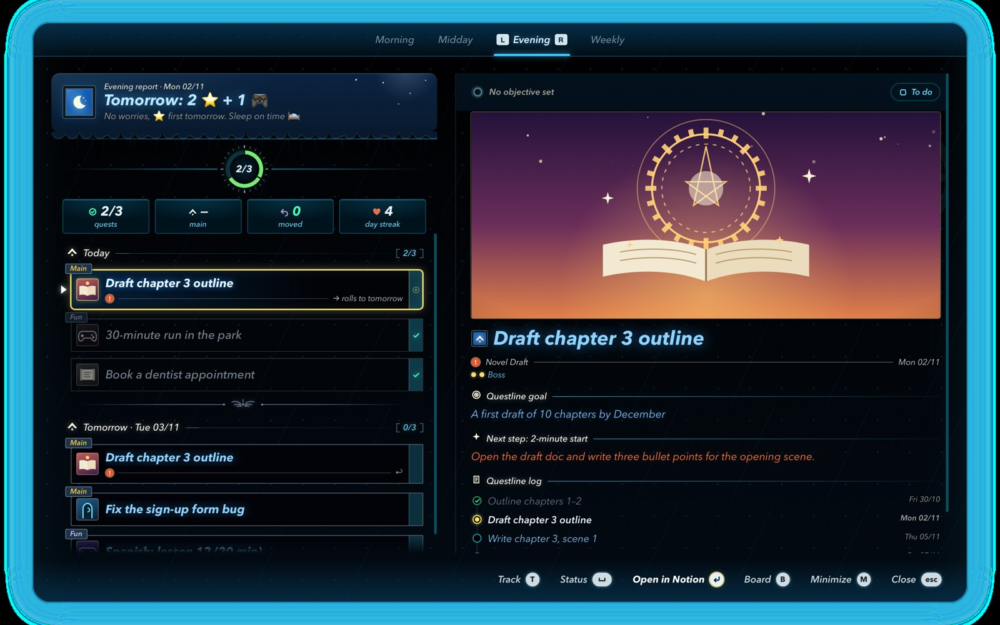
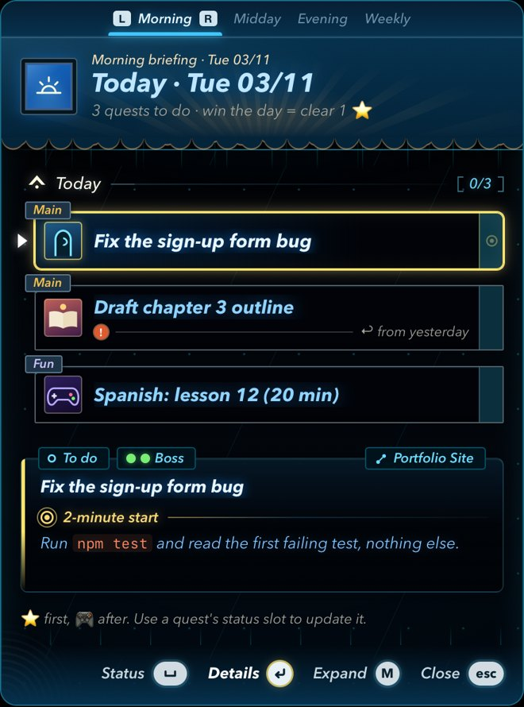
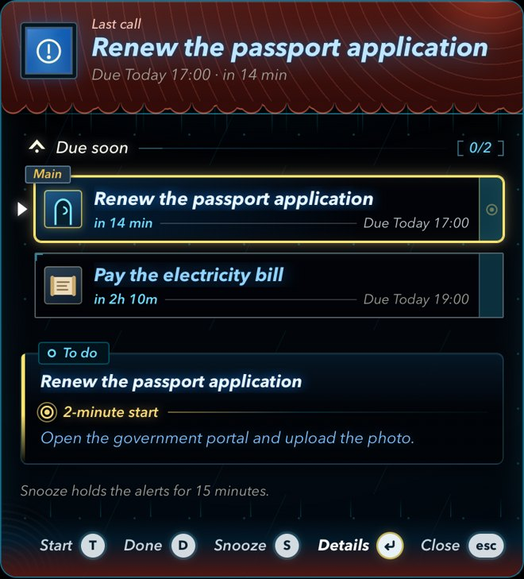
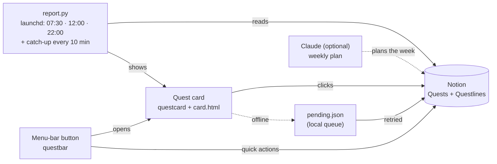

# Quest Log

A daily planner for macOS that looks like a game's quest menu. Your quests live in a Notion database; the Mac pops up a
card in the morning, at midday and in the evening, and you clear, track or postpone quests right on the card.
Every click is saved to Notion within seconds.

Made for an ADHD-friendly routine: one ⭐ Main quest a day, at least one 🎮 Fun quest, a "2-minute start" for every
quest, and nothing to remember: the cards come to you.



<p align="center">
  
  &nbsp;&nbsp;
  
</p>

<sub>Screenshots use made-up sample quests.</sub>

## What it does

- **Three cards a day**: 07:30 morning briefing (today's quests), 12:00 midday check (what is left), 22:00 evening
  report (cleared count, ⭐ done or not, day streak, tomorrow's plan).
- **Act on the card**: Clear, Track (🔥 in progress), Move to tomorrow, Undo, Open in Notion, with the keyboard or the mouse.
- **Detail panel** for each quest: illustration, questline goal, next 2-minute step, questline log.
- **Menu-bar button**: opens the card any time (⌃⌥Q), lists today's quests with quick actions, shows a tracking timer.
- **Deadlines**: give a quest a Due time and it climbs a ladder of reminders (badge → card → alert sound), with an
  optional push to your phone while you are away.
- **Works offline**: a click that can't reach Notion waits in a local queue and is sent as soon as the network is back.
- **No AI needed day to day**: everything above runs on the Mac. An AI assistant (Claude) is optional and only plans
  the coming week.

## How it works



| part | file | job |
|---|---|---|
| Card | `card.html` (HTML/CSS/SVG) + `QuestCard.swift` → `questcard` | draws the card in a floating window, sends clicks to Notion |
| Runner | `report.py` (Python 3, standard library only) | reads Notion, builds the cards, writes queued clicks, installs the schedule |
| Menu bar | `QuestBar.swift` → `questbar` | the button, quick actions, tracking timer, deadline badge |
| Queue | `pending.py` → `pending.json`, `applied.json` | clicks waiting for Notion, and a 14-day log of what was saved |
| Deadlines | `urgent.py`, `quickadd.py` | reminder ladder, phone push, "Add deadline…" |
| State | `qlstate.py`, `runs/` | which card was shown when, saved cards for offline use, logs |
| Sounds | `make_sounds.py` → `sounds/*.wav` | original menu sounds, synthesized in Python |

## Requirements

- macOS with the Xcode Command Line Tools (`xcode-select --install`) for `swiftc` and `/usr/bin/python3`.
  Built and used on macOS 26 on Apple Silicon; other recent versions should work but are untested.
- A Notion workspace with two databases laid out as in [Notion setup](#notion-setup).
- A Notion integration token (free), see [Saving "done" to Notion](#saving-done-to-notion).

## Setup

1. **Get the code** into a folder that will stay put (the schedule points at it), for example:
   ```bash
   git clone https://github.com/ThachCoder2k2/the-legend-of-zelda-questlog-with-notion.git ~/Library/Application\ Support/QuestLog
   cd ~/Library/Application\ Support/QuestLog
   ```
2. **Build the two apps and the sounds:**
   ```bash
   swiftc -O QuestCard.swift -o questcard -framework Cocoa -framework WebKit
   swiftc -O QuestBar.swift -o questbar -framework Cocoa -framework Carbon
   python3 make_sounds.py
   ```
3. **Create the Notion databases** ([Notion setup](#notion-setup)) and put their IDs in the code:
   `QUESTS_DB` and `QUESTLINES_DB` in `report.py`, and your board page in `boardURL` (`QuestCard.swift`, `QuestBar.swift`)
   and `BOARD` (`show_card.py`). Rebuild after changing the Swift files.
4. **Connect Notion** with an integration token: [Saving "done" to Notion](#saving-done-to-notion). Then check it:
   ```bash
   python3 report.py check
   ```
5. **Turn it on:**
   ```bash
   python3 report.py install --live
   ```
   This loads the LaunchAgents (07:30, 12:00, 22:00, the catch-up and the menu-bar button).
   `python3 report.py status` shows what is installed; `python3 report.py uninstall` removes it all.
6. **Try it:** click the button in the menu bar, or run `python3 report.py now`.

Just want to look at the design? Open `card.html` in Safari with `?kind=morning`, `midday`, `evening`, `weekly` or
`urgent` at the end of the address: it shows sample data and needs nothing else.

## Using it

**When cards appear**

| card | time | shown if you are at the Mac between |
|---|---|---|
| Morning briefing | 07:30 | 07:00 and 11:30 |
| Midday check | 12:00 | 11:30 and 21:30 |
| Evening report | 22:00 | 21:30 and 04:00 (after midnight it is still the previous day's report) |

If the Mac was asleep, off or you were away, the card shows once you are back, never stacked and never on top of an
open card.

**Controls**

| input | action |
|---|---|
| hover, ↑ / ↓ (or j / k) | move the gold cursor |
| click the slot at a quest's right end, or T | track it (one tracked quest at a time); again = untrack |
| Space | action menu: Clear · Track · Move to tomorrow · To do · Undo · Open in Notion |
| Enter, →, double-click | detail panel |
| Enter in the detail panel | open the quest in Notion |
| B | open the board in Notion |
| M | full screen ⇄ corner card |
| Esc | close the menu, then the detail panel, then the card |
| drag the header | move the corner card |

Keys work only after you click the card once, so typing in another app never reaches it.
The card opens full screen; `"display": "compact"` in its data opens it as the corner card.

**Menu-bar button**: click or ⌃⌥Q opens the card for the time of day (or the last saved one when offline).
Right-click for today's quests (Clear · Track · Move to tomorrow · Open), the other cards, "Add deadline…" (⌃⌥D) and
the board. Next to the icon: today's cleared/total, or "▶ 12m" while a quest is tracked, or "!" when a deadline is close.

**Deadlines**: give a quest a **Due** date and time in Notion, or type one line in "Add deadline…", for example
`Pay rent, fri 17:00` or `Call the bank in 3h`.

| time left | what happens |
|---|---|
| 3 h | amber badge, one quiet card |
| 1 h | red blinking badge, card with a sound |
| 15 min | card with the alert sound, again every 10 min |
| overdue | alert card again every 30 min (stops 3 days later) |

The urgent card has **Start** (T), **Done** (D) and **Snooze 15 min** (S).

## Saving "done" to Notion

The Mac needs its own key to Notion, an integration token. With it, every click on the card or in the menu bar is
written to Notion within seconds. A click that can't be written right away (offline, Notion down) waits in
`pending.json` and is retried at login, after a wake-up and every 10 minutes; until then the menu bar shows
"⏳ N changes not in Notion yet: save now". Without a token, clicks only wait in the queue.

1. Open [notion.so/profile/integrations](https://www.notion.so/profile/integrations) → **New integration** (or New
   connection) → type **Internal** / **API token**, pick your workspace, Save.
2. **Capabilities**: Read content, Update content, Insert content ("Add deadline…" needs Insert).
   User capabilities: No user information.
3. **Content access** (or, on the page: ••• → Connections → Connect to): add the page that **contains the two
   databases**. Connecting only a board page that shows them is not enough (every call would fail with 404).
4. Copy the token, then right-click the menu-bar button → "⚠ Notion isn't connected: set it up…". A Terminal window
   opens (`set-notion-token.command`): paste the token, press Return, paste it again, Return. Nothing shows while you
   paste; that is normal. It is stored in the macOS Keychain (service `QuestLog Notion`, account `token`), never in a file.

Check it with `python3 report.py check`. Remove it with `security delete-generic-password -s "QuestLog Notion" -a token`.

## Notion setup

**Quests** database

| property | type | values |
|---|---|---|
| Quest | title | |
| Type | select | `⭐ Main Quest`, `🧩 Side Quest`, `🎮 Fun` |
| Status | status | `📜 To Do`, `🔥 Grinding`, `⏸ Delay`, `✅ Cleared` |
| Date | date | the day it is planned for |
| Energy | select | `🐸 Mobs` (light), `🐉 Boss` (heavy), `🔒 Locked` (ignored) |
| 2-Min Start | text | the tiny first step, shown as "Next step" |
| Questline | relation → Questlines | |
| Due | date with time | optional deadline |
| Edited | last edited time | |
| On Today | formula (optional) | `"yes"` for quests on today's list; without it a built-in rule is used |

**Questlines** database: `Questline` (title), `Done means` (text, shown as the questline goal), `Quests` (relation).

Quests without a Date sit on a "Quest Board" backlog. Each questline can have its own illustration: add a banner, a
tile and a name pattern to `ART` in `card.html`; other quests get the Main / Side / Fun default art.

## Optional: Claude as the weekly planner

Claude (Anthropic's AI assistant) can run as a scheduled task on Sunday evening: it reads the board, carries unfinished
quests into next week, gives every day one ⭐ Main and at least one 🎮 Fun quest, and pops up the week as a card. It
writes to Notion through its own Notion connector and applies any queued clicks first. The prompt is not part of this
repository. Nothing else depends on it: if it doesn't run, unfinished quests simply show up as carried ("↩︎") on the
next morning card.

## Reference

<details>
<summary><b>report.py commands</b></summary>

| command | does |
|---|---|
| `python3 report.py morning` (or `midday`, `evening`) | write queued clicks, read Notion, show the card |
| `… --dry-run` | print the card JSON only: no Notion writes, queue untouched, no card |
| `… --today 2026-10-21` | build the card for another day |
| `python3 report.py now [KIND]` | open a card now (what the menu-bar button runs) |
| `python3 report.py apply` | write the queued clicks to Notion now |
| `python3 report.py catchup` | what the 10-minute agent runs: send queued clicks, deadlines, a missed card |
| `python3 report.py add -- "TITLE, WHEN"` | create a deadline quest |
| `python3 report.py status` | mode, token, which cards were shown today, saved cards |
| `python3 report.py check` | token, Notion access, row counts |
| `python3 report.py install [--live]` / `uninstall` | LaunchAgents in `~/Library/LaunchAgents/com.questlog.*` |
| `python3 report.py shadow KIND`, `compare KIND` | compare the cards with ones made by a Claude task (see below) |

`install` without `--live` installs **shadow mode**: the agents only build cards in the background and compare them
with the cards a Claude task showed (`runs/compare.log`). It was used to check the local runner against Claude before
switching over. Queued clicks are written in both modes.
</details>

<details>
<summary><b>Catch-up after sleep, shutdown or time away</b></summary>

- launchd runs a job that was due during sleep as soon as the Mac wakes; `questbar` also runs the catch-up 5 s after a
  wake-up or an unlock.
- `com.questlog.catchup` runs at login and every 10 minutes. It first writes queued clicks to Notion, then shows the one
  card that is due and unseen, only once you are back (keyboard or mouse used in the last 10 minutes) and never on top
  of an open card. A newer card covers older ones, so a late start shows one card, not three.
- On Sundays the evening window ends at 22:30, when the weekly plan may start moving quests.
- Every card shown is saved in `runs/last-KIND.json`, so the menu-bar button works offline; a saved card says when it
  was made ("Saved 22:11").
</details>

<details>
<summary><b>Phone push for deadlines (ntfy.sh, off by default)</b></summary>

While you are away from the Mac (no input for 10 minutes, or the screen locked) and the Mac is awake, the 1 h, 15 min
and overdue steps go to your phone through [ntfy.sh](https://ntfy.sh) instead of waiting for a card.

```bash
python3 urgent.py push setup     # makes push.json (private, not in git) with a random topic
python3 urgent.py push sample    # shows exactly what would be sent
python3 urgent.py push enable    # also: disable | status | test | newtopic
```

Install the ntfy app and subscribe to the topic. Anyone who knows the topic can read the notifications, so treat it
like a password; set `"titles": false` in `push.json` to send no quest titles or links.
</details>

<details>
<summary><b>Card data (JSON)</b></summary>

`python3 show_card.py card.json` shows any card (it falls back to a plain dialog if `questcard` is missing).

| field | type | notes |
|---|---|---|
| kind | `"morning"` \| `"midday"` \| `"evening"` \| `"weekly"` \| `"urgent"` | colour theme and icon; urgent = the deadline card |
| eyebrow, title, subtitle | string | header lines (subtitle optional) |
| progress | `{done, total}` | optional stamina wheel |
| stats | `[{icon, value, label}]` | optional chips |
| sections | `[{heading, items, empty}]` | quest lists; `empty` = text when there are no items |
| xp | `[{name, done, total}]` | optional progress bars per questline (weekly) |
| callout | `{label, text}` | a 2-minute start for older data without `start` |
| note | string | small line at the bottom |
| url | string | board link for "Board" |
| display | `"full"` \| `"compact"` | full screen (default) or corner card |
| timeoutSec | number | auto-close, default 1800 |
| sound | string | `""` mutes the card |

Item: `{type: "main"|"side"|"fun", title, url?, status?, date?, label?, tags?, live?, done?, start?, questline?, goal?, energy?, steps?}`

- `url`: the quest's Notion page; without it the row can't be opened or changed.
- `status`: the Notion Status exactly; Undo restores it. `date` (`YYYY-MM-DD`) is needed for "Move to tomorrow".
- `start`: the 2-Min Start (wrap shell commands in backticks). `steps`: the questline's quests `[{title, url?, date?, done?}]`.

Sounds: put your own files in `sounds/custom/` (same names as in `sounds/`, `.wav` `.aiff` `.caf` `.m4a` `.mp3`) to
replace the built-in ones; they stay on your Mac (`.gitignore`).
</details>

<details>
<summary><b>Tests</b></summary>

```bash
tests/run.sh
```

About 230 checks (time windows, catch-up, queue and sync, deadlines, quick add, phone push, evening numbers…) in a
throw-away sandbox: a temp copy of the scripts, a fake `questcard` and `osascript`, the network stubbed. It touches no
real state and sends nothing to Notion or ntfy.sh.
</details>

## Credits

A fan-made personal project inspired by the menu style of *The Legend of Zelda: Tears of the Kingdom*. Not affiliated
with or endorsed by Nintendo. No game assets are used: every illustration is original SVG drawn in `card.html`, and
every sound is synthesized by `make_sounds.py`.
